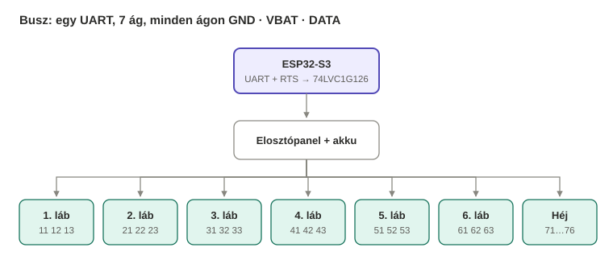

# Hexpodrobot

Hatlábú, gömbbé összecsukható robot (Kåre Halvorsen MorpHex robotja alapján), saját fejlesztésű busz-szervókkal.

## A koncepció röviden

- **24 szervó**: 6 láb × 3 ízület (csípő, comb, lábszár) + 6 felső héjszelet.
- **Saját busz-szervók**: a DS3218 és MG996R szervók gyári elektronikája helyére egy CH32V003F4U6 + DRV8876 panel kerül. Minden szervó egyetlen 1 Mbit/s-os, egyvezetékes half-duplex UART buszon kommunikál.
- **Központi vezérlő**: ESP32-S3. Egy UART-tal kezeli az összes szervót, így marad kapacitás kamerára és egyéb feladatokra.
- **Gömb**: Ø ~32 cm, 12 egyforma héjszelet (6 alsó a lábszárakon, 6 felső a nyitószervókon).
- **Táp**: 2S LiPo (4000–5000 mAh, ≥30C), a motorok közvetlenül az akkuról, PWM-mel korlátozott feszültséggel.
- **IMU**: ICM-42688-P (6 tengely, SPI).

## Mappák

| Mappa | Tartalom |
|---|---|
| [docs/busz-protokoll.md](docs/busz-protokoll.md) | Keretformátum, utasítások, regisztertábla, időzítés |
| [docs/szervopanel.md](docs/szervopanel.md) | Szervópanel: alkatrészlista, lábkiosztás, bekötés |
| [docs/mechanika.md](docs/mechanika.md) | Szervóválasztás, lábméretek, gömb, héjnyitó mechanizmus |
| [firmware/servo](firmware/servo) | CH32V003F4U6 firmware (VS Code + PlatformIO) |
| [firmware/master/HexMaster](firmware/master/HexMaster) | ESP32-S3 program (Arduino IDE): busz-teszt, beállítás, lábkinematika |
| [hardware/servo-board](hardware/servo-board) | KiCad kapcsolási rajz, PDF, saját szimbólumok |
| [mechanics](mechanics) | SolidWorks-makrók (.swb): héjszelet, szervótest, lábszakasz, héjnyitó konzol |

## Állapot

| Rész | Állapot |
|---|---|
| Koncepció, protokoll, panelterv | kész (dokumentáció) |
| Szervó firmware | első verzió, lefordul (7,8 KB flash, 0,9 KB RAM), hardveren még nem tesztelt |
| Mester program | első verzió, hardveren még nem tesztelt |
| KiCad kapcsolási rajz | kész, netlista ellenőrizve ([hardware/servo-board](hardware/servo-board)) |
| KiCad NYÁK | következő lépés |
| Mechanika (SolidWorks) | első makrók kész, SolidWorksben még nem futtatva |

## Első lépések

1. **Szervó szétszedése:** egy MG996R és egy DS3218 esetén mérd meg a potméter ellenállását, a teljes elfordulást, és a motor tekercsellenállását.
2. **Próbapanel:** CH32V003 fejlesztőpanel + DRV8876 modul + egy szervó motorja és potmétere.
3. **Szervó firmware:** VS Code + PlatformIO, `firmware/servo` mappa megnyitása, `ds3218` vagy `mg996r` környezet, feltöltés WCH-LinkE programozóval (SWIO láb).
4. **Mester:** Arduino IDE, `firmware/master/HexMaster/HexMaster.ino`, alaplap: ESP32S3 Dev Module. A soros monitoron (115200, „Új sor”) a `sugo` parancs listázza a lehetőségeket.
5. **Élesztés a soros monitorról:** `scan` → `ping 1` → `nulla 1` → `nyomatek 1 1` → `mozgat 1 30 500` → `allapot 1`.
6. **PID-hangolás:** `ir 1 0x10 <Kp> 2`, `ir 1 0x14 <Kd> 2` (kikapcsolt nyomatéknál), majd újra `mozgat`.
7. **ID kiosztás:** `id 1 12` stb., a [protokoll](docs/busz-protokoll.md#id-kiosztás) táblázata szerint.

## Ellenőrizendő élesztés előtt

- A DRV8876 HTSSOP-16 footprint hűtőpad-méretét a TI PWP rajzával egyeztetni.
- A beállítások flash-címe (`SETTINGS_FLASH_ADDR`) és a CH32V003 törlési egysége.
- Az ESP32-S3 RTS-polaritása RS485 módban (74LVC1G126 vagy 74LVC1G125).
