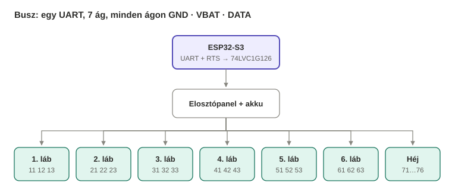

# Busz-protokoll

Egyetlen adatvezeték, 3,3 V-os logika, **1 Mbit/s, 8N1**, half-duplex. A keret Dynamixel 1.0 / Feetech SCS-stílusú. A többbájtos értékek **little-endian** sorrendűek, a szögek 0,1 fokos előjeles int16 egységben vannak (−135,0° … +135,0°).



## ID-kiosztás

Lábanként tízes csoport: az első számjegy a láb, a második az ízület.

| ID | Hely | Szervó |
|---|---|---|
| 11, 21, 31, 41, 51, 61 | Csípő (coxa), 1–6. láb | MG996R |
| 12, 22, 32, 42, 52, 62 | Comb (femur), 1–6. láb | DS3218 |
| 13, 23, 33, 43, 53, 63 | Lábszár (tibia), 1–6. láb | DS3218 |
| 71–76 | Felső héjszeletek | MG996R |
| 1 | Gyári alapérték új panelen | – |
| 254 (0xFE) | Broadcast | – |

## Keretformátum

| Bájt | Parancs (mester → szervó) | Válasz (szervó → mester) |
|---|---|---|
| 0–1 | `0xFF 0xFF` | `0xFF 0xFF` |
| 2 | ID (0xFE = broadcast) | ID |
| 3 | LEN = paraméterek száma + 2 | LEN = adatbájtok száma + 2 |
| 4 | Utasítás | Hibabájt |
| 5 … | Paraméterek | Adat |
| utolsó | `CHK = ~(ID + LEN + utasítás + paraméterek) & 0xFF` | ugyanígy, a hibabájttal |

Broadcast parancsra egyetlen szervó sem válaszol, a SYNC_READ kivételével.

## Utasítások

| Kód | Név | Paraméterek | Válasz |
|---|---|---|---|
| 0x01 | PING | – | állapotcsomag |
| 0x02 | READ | cím, hossz | a kért bájtok |
| 0x03 | WRITE | cím, adat… | állapotcsomag |
| 0x04 | REG_WRITE | cím, adat… (max. 16 bájt, pufferelve) | állapotcsomag |
| 0x05 | ACTION | – (a pufferelt írások végrehajtása) | nincs |
| 0x06 | FACTORY_RESET | – (csak kikapcsolt nyomatéknál) | állapotcsomag, utána ID = 1 |
| 0x82 | SYNC_READ | cím, hossz, ID1 … IDn | sorban, időrésekben |
| 0x83 | SYNC_WRITE | cím, hossz, (ID, adat…) × n | nincs |

**SYNC_READ:** minden szervó megkeresi magát a listában, és `válaszkésleltetés + sorszám × időrés` után válaszol. Időrés = (6 + hossz) × 10 µs + 20 µs (1 Mbit/s-on). A mester a válaszokat ID alapján rendeli a listához, így egy hiányzó szervó nem csúsztatja el a többit.

**ID és baud változtatása:** az új érték a válaszcsomag után lép életbe, így a válasz még a régi ID-vel érkezik.

### Példa: SYNC_WRITE, 1. láb célpozíciói

Csípő (11) +45,0°, comb (12) −30,0°, lábszár (13) +90,0°, a 0x2A címre, 2 bájttal:

```
FF FF FE 0D 83 2A 02  0B C2 01  0C D4 FE  0D 84 03  05
```

450 = 0x01C2, −300 = 0xFED4, 900 = 0x0384; az ellenőrzőösszeg ~0xFA = 0x05.

## Regisztertábla

A 0x00–0x27 tartomány beállítás (flash-be mentve), a 0x28-tól kezdődő futásidejű (RAM). Beállítást csak kikapcsolt nyomatéknál lehet írni. A flash-mentés kb. 0,1 s csend után, kikapcsolt nyomatéknál történik.

| Cím | Méret | Név | Hozzáférés | Egység | Alapérték |
|---|---|---|---|---|---|
| 0x00 | 2 | Modellszám | R | – | 0x0301 = DS3218, 0x0302 = MG996R |
| 0x02 | 1 | Firmware-verzió | R | – | 1 |
| 0x05 | 1 | ID | RW | – | 1 |
| 0x06 | 1 | Baud-kód | RW | 0 = 1 Mbit/s, 1 = 500 kbit/s | 0 |
| 0x07 | 1 | Válaszkésleltetés | RW | 2 µs | 10 |
| 0x08 | 2 | Min. szög | RW | 0,1° | −1350 |
| 0x0A | 2 | Max. szög | RW | 0,1° | +1350 |
| 0x0C | 2 | Potméter-nullpont | RW | ADC-összeg (0…16368) | 8184 |
| 0x0E | 1 | Irány | RW | 0 / 1 | 0 |
| 0x10 | 2 | Kp | RW | PWM-lépés / 0,1° × 1/256 | 1536 |
| 0x12 | 2 | Ki | RW | lásd lent | 0 |
| 0x14 | 2 | Kd | RW | PWM-lépés / (0,1°/ms) × 1/256 | 5120 |
| 0x16 | 2 | Max. PWM-kitöltés | RW | ‰ | 800 |
| 0x18 | 2 | Áramkorlát | RW | mA | 2500 |
| 0x1A | 1 | Max. hőmérséklet | RW | °C (0 = nincs NTC) | 70 |
| 0x1B | 1 | Watchdog | RW | 10 ms (0 = ki) | 20 |
| 0x1C | 2 | Potméter-skála | RW | 0,1° a teljes ADC-tartományra | 3000 |
| 0x28 | 1 | Nyomaték be | RW | 0 / 1 | 0 |
| 0x29 | 1 | LED | RW | 0 / 1 | 0 |
| 0x2A | 2 | Célpozíció | RW | 0,1° | – |
| 0x2C | 2 | Mozgásidő | RW | ms (0 = max. sebesség) | 0 |
| 0x2E | 2 | Max. sebesség | RW | °/s (0 = korlátlan) | 0 |
| 0x38 | 2 | Aktuális pozíció | R | 0,1° | – |
| 0x3A | 2 | Aktuális sebesség | R | °/s | – |
| 0x3C | 2 | Motoráram | R | mA, előjeles | – |
| 0x3E | 1 | Tápfeszültség | R | 0,1 V | – |
| 0x3F | 1 | Hőmérséklet | R | °C | – |
| 0x40 | 1 | Hibabitek | R | lásd lent | – |
| 0x41 | 1 | Mozgásban | R | 0 / 1 | – |

A 0x38–0x41 állapotblokk egyben, 10 bájtként olvasható.

**PID:** `u = (Kp·e − Kd·Δpos) / 256 + Ki·(integ / 64) / 1024`, ahol `u` PWM-lépés (teljes skála 2399), `e` és `Δpos` 0,1 fokban, `integ` 0,1° × ms. A Kp = 1536 (= 6 × 256) kiinduló érték: 10° hibára kb. 25% kitöltés.

**Pozíció:** `pos = (ADC-összeg − nullpont) × skála / 16368`, irány = 1 esetén előjelváltással. A `nulla` parancs (HexMaster) a mostani állást állítja 0 fokra.

**Mozgás:** ha a mozgásidő > 0, a szervó egyenletes sebességgel pont ennyi idő alatt ér a célba. Ha 0, de a max. sebesség > 0, azzal a sebességgel megy. Ha mindkettő 0, azonnal a célra szabályoz.

## Hibabájt

| Bit | Jelentés | Mit csinál a szervó |
|---|---|---|
| 0 | Feszültség a tartományon kívül (6,0–8,6 V) | Nyomaték ki |
| 1 | Célpozíció a szöghatáron kívül | Levágja a határra |
| 2 | Túlmelegedés | Nyomaték ki |
| 3 | Érvénytelen cím, hossz vagy írás bekapcsolt nyomatéknál | Parancs eldobva |
| 4 | Hibás ellenőrzőösszeg | Parancs eldobva |
| 5 | Túlterhelés: az áramkorlát 0,5 s-nál tovább aktív | Nyomaték ki |
| 6 | Ismeretlen utasítás | Parancs eldobva |
| 7 | Meghajtóhiba (nFAULT) vagy lejárt busz-watchdog | Nyomaték ki |

A nyomatékot kikapcsoló hibák (0, 2, 5, 7) addig maradnak, amíg a mester újra 1-et nem ír a 0x28-ra.

## Időzítés (24 szervó, 1 Mbit/s)

| Lépés | Bájt | Idő |
|---|---|---|
| SYNC_WRITE, célpozíció (2 B × 24) | 80 | 0,80 ms |
| SYNC_READ kérés (24 ID) | 31 | 0,31 ms |
| 24 válasz állapotblokkal (16 B + 20 µs) | 384 | 4,32 ms |
| **Összesen** | 495 | **kb. 5,4 ms** |

Belefér egy 100 Hz-es (10 ms-os) vezérlési ciklusba. Mozgásidővel együtt (4 B szervónként) kb. 5,9 ms.
