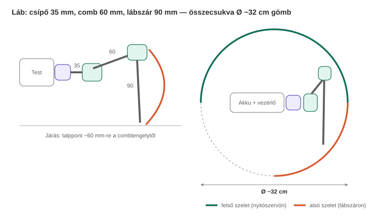
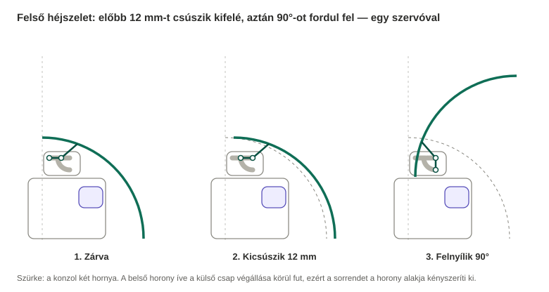

# Mechanika

## Szervóválasztás

| Hely | Darab | Szervó | Indok |
|---|---|---|---|
| Comb (femur) | 6 | DS3218 | Itt a legnagyobb a terhelés |
| Lábszár (tibia) | 6 | DS3218 | Biztonságos tartalék |
| Csípő (coxa) | 6 | MG996R | Vízszintes forgás, kisebb terhelés |
| Felső héjszeletek | 6 | MG996R | Könnyű szeletek |

| | DS3218 | MG996R |
|---|---|---|
| Elakadási nyomaték | 18–19 kg·cm (5 V), 21,5 kg·cm (6,8 V) | 9,4 kg·cm (4,8 V), 11 kg·cm (6 V) |
| Elakadási áram | 1,8 A (5 V), 2,6 A (6,8 V) | 2,5 A (6 V) |
| Méret | 40 × 20 × 40,5 mm | ~40,7 × 19,7 × 42,9 mm |
| Tömeg | 60 g | 55 g |
| Forgási tartomány | 180° vagy 270° változat | ~120–180° |

A két szervó befoglaló mérete gyakorlatilag azonos, így ugyanaz a tartókonzol és ugyanaz a szervópanel jó mindkettőbe.

## Terhelésbecslés

- 25 standard szervó ~1,5 kg, héjjal, vázzal és akkuval a robot **2,5–3 kg**.
- Hármas járásnál (tripod) egy lábra ~0,9 kg jut.
- Járásnál a talppont ~60 mm-re van a combtengelytől: **~5,5 kg·cm**, ez a DS3218 18 kg·cm-éhez képest háromszoros tartalék (felálláshoz, kinyíláshoz).
- 10 cm-es kinyújtott lábnál ~9 kg·cm, kétszeres biztonsággal ~18 kg·cm.

## Lábméretek

| Szakasz | Hossz |
|---|---|
| Csípőtengely → combtengely | 35 mm |
| Comb | 60 mm |
| Lábszár | 90 mm |

Az inverz kinematika a `firmware/master/HexMaster/LegIK.h` fájlban van.

## Gömb

Sugárirányban az egyenlítőnél:

| Rész | Méret |
|---|---|
| Központi mag (akku, ESP32-S3, IMU) | ~50 mm |
| Csípőszervó + csípőkar | ~35 mm |
| Combszervó | ~40 mm |
| Térdszervó, rés, héjvastagság | ~35 mm |
| **Sugár / átmérő** | **~160 mm / ~32 cm** |

Ha a combszervót 90°-kal elforgatva, a 20 mm-es oldalával kifelé építed be, ~28 cm-es gömb is elérhető, de ehhez a combnál szögáthajtás vagy lapos kar kell.

**12 egyforma héjszelet:** mindegyik 60° széles és 90° magas gömbcikk (a gömb 1/12-e). Az alsó hat a lábszárakon ül, a felső hat a nyitószervókon. A különbség csak a tartókonzolban van. Egyforma szeletekkel a gömb szimmetrikus, ezért egyenesebben gurul, mint az eredeti MorpHex.

## Felső héjszelet nyitása

- A szelet belső tartókarján két csap van, egy rögzített konzol két hornyában futnak.
- **1. fázis, csúszás (12 mm):** amíg mindkét csap az egyenes horonyszakaszban jár, a szelet csak kifelé csúszhat. Ekkor szabadul ki a csúcsa a többi öt közül.
- **2. fázis, forgás (90°):** a külső csap a horonyvégen megáll. A belső csap hornya itt ívben lefelé fordul, és ennek az ívnek a középpontja a külső csap végállása. A szelet így csak a külső csap körül fordulhat.
- Mindkét fázist egyetlen MG996R hajtja tolórúddal, rugó nélkül.
- A hornyokba 3 mm-es acélcsap és rézhüvely kerüljön. A 12 mm-es csúszást az első összerakott szeleteken kell kimérni.
- Ha nyitás közben megugrik az áram, a szelet beakadt, és a vezérlő visszahúzhatja.

## Következő lépések

- [x] SolidWorks-makrók: héjszelet, szervó burkolótest, lábszakasz-lemez, héjnyitó konzol ([mechanics](../mechanics))
- [ ] SolidWorks: szervótartó konzol (DS3218/MG996R közös)
- [ ] SolidWorks: a héjszelet két tartókonzolja (lábszár, nyitószervó)
- [ ] SolidWorks: héjnyitás összeállítása és Motion-szimulációja
- [ ] Központi mag: 6 csípőszervó hatszögben, akku, elektronika
