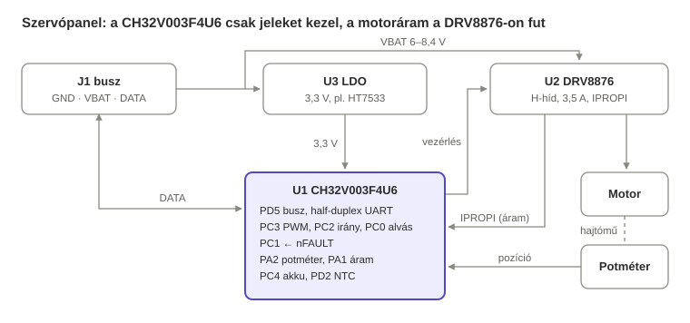

# Szervópanel

A gyári szervóelektronika helyére kerülő panel: **CH32V003F4U6** (QFN-20, 3 × 3 mm), **DRV8876RGT** (VQFN-16) H-híd beépített árammérő kimenettel és egy 3,3 V-os LDO. Tervezett méret kb. 18 × 30 mm, kétoldalas, a DS3218 és az MG996R házába is befér. A motor, a hajtómű és a potméter marad.

## Alkatrészek

| Pozíció | Alkatrész | Feladat |
|---|---|---|
| U1 | CH32V003F4U6 (QFN-20) | 48 MHz RISC-V, 16 KB flash, 2 KB RAM, 10 bites ADC |
| U2 | DRV8876RGT (VQFN-16, 3 × 3 mm) | H-híd, 4,5–37 V, 3,5 A csúcs, IPROPI áramtükör-kimenet |
| U3 | HT7533-1 (SOT-89: 1 GND, 2 VIN, 3 VOUT) | Logikai táp a 2S akkuról, Vin max. 30 V, 100 mA |
| C1 | 100 µF / 16 V polimer vagy elektrolit | Motortáp puffer a VM lábnál |
| C2, C3 | 100 nF + 10 µF kerámia | VM és 3,3 V szűrés |
| R1 | 1 kΩ | IPROPI → ~1 V/A az ADC-nek |
| R2, R3 | 100 kΩ / 33 kΩ | Akkufeszültség-osztó, 8,4 V → 2,1 V |
| R4 + C4 | 1 kΩ + 100 nF | Potméter-csúszka RC szűrője |
| R5 | 100 Ω | Soros ellenállás a busz DATA vonalán |
| D1 | ESD-dióda (pl. PESD3V3) | Adatvonal védelem |
| R6, R7 | 10 kΩ / 33 kΩ, 1% | VREF ≈ 2,53 V → hardveres áramkorlát ≈ 2,5 A |
| R11 | 10 kΩ | nFAULT felhúzó |
| R8 | 10 kΩ | NRST felhúzó |
| LED1 | 0603 LED + 1 kΩ | Állapot / hiba (hibánál villog) |
| NTC | 10 kΩ NTC, B = 3950 + 10 kΩ felhúzó (opcionális) | Motor-hőmérséklet |
| J1 | 3 tűs csatlakozó / a szervó saját kábele | GND · VBAT · DATA |
| TP | SWIO, 3V3, GND pad | Programozás WCH-LinkE-vel |

DRV8876 bekötés: **PMODE = GND (PH/EN mód)**, **IMODE = GND** (fix kikapcsolási idő, automatikus újraindítás), EN = PWM, PH = irány, nSLEEP és nFAULT a mikrokontrollerre. Az IPROPI-erősítés 1000 µA/A (TI adatlap), 1 kΩ-mal 1 V/A. A teljes kapcsolási rajz: [hardware/servo-board](../hardware/servo-board).

## Lábkiosztás

| Port | QFN-20 láb | Funkció | Bekötés |
|---|---|---|---|
| PD5 | 19 | USART1_TX, half-duplex | Busz DATA, R5 + D1 át |
| PD1 | 15 | SWIO | Programozó pad |
| PD7 | 1 | NRST | R8 felhúzó |
| PC3 | 10 | TIM1_CH3 PWM, 20 kHz | DRV8876 EN/IN1 |
| PC2 | 9 | GPIO kimenet | DRV8876 PH/IN2 (irány) |
| PC0 | 7 | GPIO kimenet | DRV8876 nSLEEP |
| PC1 | 8 | GPIO bemenet, belső felhúzó | DRV8876 nFAULT |
| PC5 | 12 | GPIO kimenet | Állapot-LED |
| PA2 | 3 | ADC CH0 | Potméter csúszka |
| PA1 | 2 | ADC CH1 | IPROPI (motoráram) |
| PC4 | 11 | ADC CH2 | Akkufeszültség-osztó |
| PD2 | 16 | ADC CH3 | NTC (opcionális) |
| PD6, PD0, PD3, PD4, PC6, PC7 | 20, 5, 17, 18, 13, 14 | szabad | – |

## Bekötési megjegyzések

- A potméter két vége 3,3 V-ra és GND-re kerül. Így az ADC referenciája és a potméter ugyanarról a tápról megy, és a tápingadozás kiesik a mérésből.
- A 10 bites ADC 16-szoros túlmintavételezéssel kb. 12 bit effektív felbontást ad. 270°-os potméterre ez kb. 0,07° lépés.
- A motoráram hurka (VBAT → C1 → DRV8876 → motor → GND) legyen rövid és széles, és ne fusson az ADC-jelek alatt.
- A DRV8876 hűtőpadját több via kösse az alsó GND-plánhoz.
- A busz VBAT vezetéke a **nyers 2S akkufeszültség (6,0–8,4 V)**. Gyári elektronikájú szervót soha ne dugj erre a buszra.

## Busz – mester oldal (ESP32-S3)

- TX (GPIO17) → **74LVC1G126** puffer → DATA. A puffer OE bemenetét az RTS (GPIO8) vezérli. Az ESP32 UART RS485 half-duplex módban fut, és adás alatt automatikusan kezeli az RTS-t. Ha a polaritás fordított, 74LVC1G125 kell helyette.
- RX (GPIO18) ← DATA, 1 kΩ soros ellenálláson át.
- 4,7 kΩ felhúzó a DATA vonalon 3,3 V-ra, csak a mesternél.

## Vezetékezés

- Középen egy elosztópanel ül, erről 7 ág indul (6 láb + héjgyűrű).
- Lábanként egy kis elosztó a combnál. A szervók gyári 3 eres kábele maradhat: barna = GND, piros = VBAT, narancs = DATA.
- VBAT és GND áganként legalább 20 AWG. Egy láb 3 szervója csúcsban 6–7 A-t is húzhat. Szervónként JST XH (3 A) csatlakozó.
