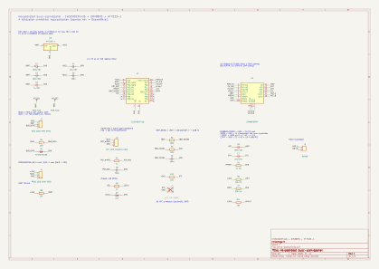

# Szervópanel – KiCad

Kapcsolási rajz: `servo-board.kicad_sch` (KiCad 7 formátum, KiCad 8/9 megnyitja és frissíti), PDF: [servo-board.pdf](servo-board.pdf).
A saját szimbólumok a projekt mellé tett `Hexpod.kicad_sym` könyvtárban vannak (`sym-lib-table` be van állítva).

A hálózatok címkékkel kapcsolódnak: az azonos nevű címkék össze vannak kötve. A rajz netlistáját géppel ellenőriztem, mind a 92 lábkötés a terv szerinti.

## Fő IC-k

| Jel | Alkatrész | Tok | Megjegyzés |
|---|---|---|---|
| U1 | CH32V003F4U6 | QFN-20 3 × 3 mm, 0,4 mm | EP (21) = VSS |
| U2 | DRV8876PWP | HTSSOP-16 + hűtőpad (17) | PMODE = GND (PH/EN), IMODE = GND |
| U3 | HT7533-1 | SOT-89 (1 GND, 2 VIN, 3 VOUT) | Vin max. 30 V, 100 mA |

## CH32V003F4U6 lábkiosztás (QFN-20)

| Láb | Port | Funkció | Hálózat |
|---|---|---|---|
| 1 | PD7 | NRST | NRST (R8 10k felhúzó) |
| 2 | PA1 | ADC A1 | IPROPI |
| 3 | PA2 | ADC A0 | POT_ADC |
| 4 | VSS | | GND |
| 5 | PD0 | – | nem bekötött |
| 6 | VDD | | +3V3 |
| 7 | PC0 | GPIO | nSLEEP |
| 8 | PC1 | GPIO | nFAULT |
| 9 | PC2 | GPIO | PH_DIR |
| 10 | PC3 | TIM1_CH3 | PWM_EN |
| 11 | PC4 | ADC A2 | VBAT_SENSE |
| 12 | PC5 | GPIO | LED |
| 13 | PC6 | – | nem bekötött |
| 14 | PC7 | – | nem bekötött |
| 15 | PD1 | SWIO | SWIO (programozás) |
| 16 | PD2 | ADC A3 | NTC |
| 17 | PD3 | – | nem bekötött |
| 18 | PD4 | – | nem bekötött |
| 19 | PD5 | USART1_TX | DATA (busz) |
| 20 | PD6 | – | nem bekötött |
| 21 | EP | | GND |

A lábkiosztás a CH32V003F4U6 QFN-20 kiosztási ábrájával egyeztetve (2026-11-14): minden láb egyezik.

## Alkatrészlista

| Jel | Érték | Tok | Funkció |
|---|---|---|---|
| C1 | 100 µF / 16 V polimer | 5 × 5,4 mm | VBAT puffer a DRV8876 VM-nél |
| C2 | 100 nF / 25 V | 0402 | VM szűrés |
| C3 | 1 µF / 25 V | 0603 | LDO bemenet |
| C4 | 10 µF / 10 V | 0603 | LDO kimenet |
| C5 | 100 nF | 0402 | U1 VDD |
| C6 | 100 nF / 16 V | 0402 | DRV8876 VCP–VM |
| C7 | 22 nF / 25 V (VM-tűrésű) | 0402 | DRV8876 CPH–CPL |
| C8 | 100 nF | 0402 | Potméter RC szűrő |
| C9 | 100 nF | 0402 | Akkufeszültség-mérés szűrő |
| R1 | 1 kΩ 1% | 0402 | IPROPI → 1 V/A |
| R2 / R3 | 100 kΩ / 33 kΩ | 0402 | Akkufeszültség-osztó |
| R4 | 1 kΩ | 0402 | Potméter RC szűrő |
| R5 | 100 Ω | 0402 | Busz soros ellenállás |
| R6 / R7 | 10 kΩ 1% / 33 kΩ 1% | 0402 | VREF ≈ 2,53 V → áramkorlát ≈ 2,5 A |
| R8 | 10 kΩ | 0402 | NRST felhúzó |
| R9 | 1 kΩ | 0402 | LED |
| R10 | 10 kΩ | 0402 | NTC felhúzó |
| R11 | 10 kΩ | 0402 | nFAULT felhúzó |
| D1 | PESD3V3S1BB (vagy hasonló 3,3 V TVS) | SOD-323 | Busz ESD-védelem |
| D2 | LED | 0603 | Állapot |
| J1 | Busz: GND, VBAT, DATA | 3 forrpad / 2 mm-es tüske | A szervókábel ide forrasztva |
| J2 | Motor A, B | 2 forrpad | |
| J3 | Potméter: 3V3, csúszka, GND | 3 forrpad | |
| J4 | Programozás: 3V3, SWIO, GND | 3 pad | Rugós tűs befogóhoz |
| J5 | NTC (opcionális) | 2 pad | Nem kell beültetni |

## A NYÁK-tervhez

- A footprintek a KiCad alapkönyvtár neveire hivatkoznak. A DRV8876 HTSSOP-16 hűtőpadjának méretét (`Package_SO:HTSSOP-16-1EP_...`) a TI PWP rajzával egyeztetni kell, ha a KiCad-verziódban más a név, a footprint-hozzárendelésnél cseréld.
- A motoráram hurka (C1 → VM → OUT1/OUT2 → motor → PGND) legyen rövid és széles, ne fusson az ADC-jelek (PA1, PA2, PC4) alatt.
- U2 hűtőpadja (17) legalább 4–6 viával kapcsolódjon az alsó GND-plánhoz.
- C4 és C5 az U1 VDD lába mellé, C6 és C7 közvetlenül a DRV8876 lábaihoz.
- Méretcél: kb. 18 × 30 mm, kétoldalas, hogy a DS3218 és az MG996R házába is beférjen.
